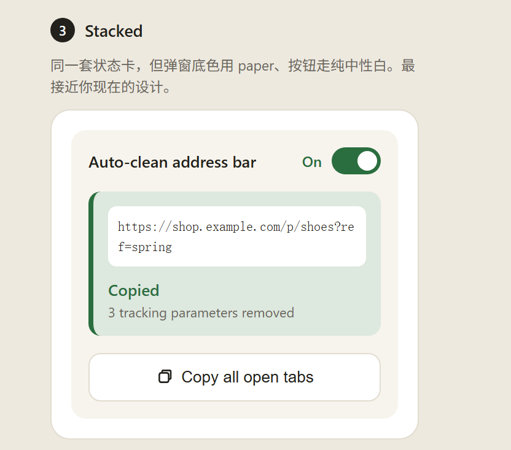
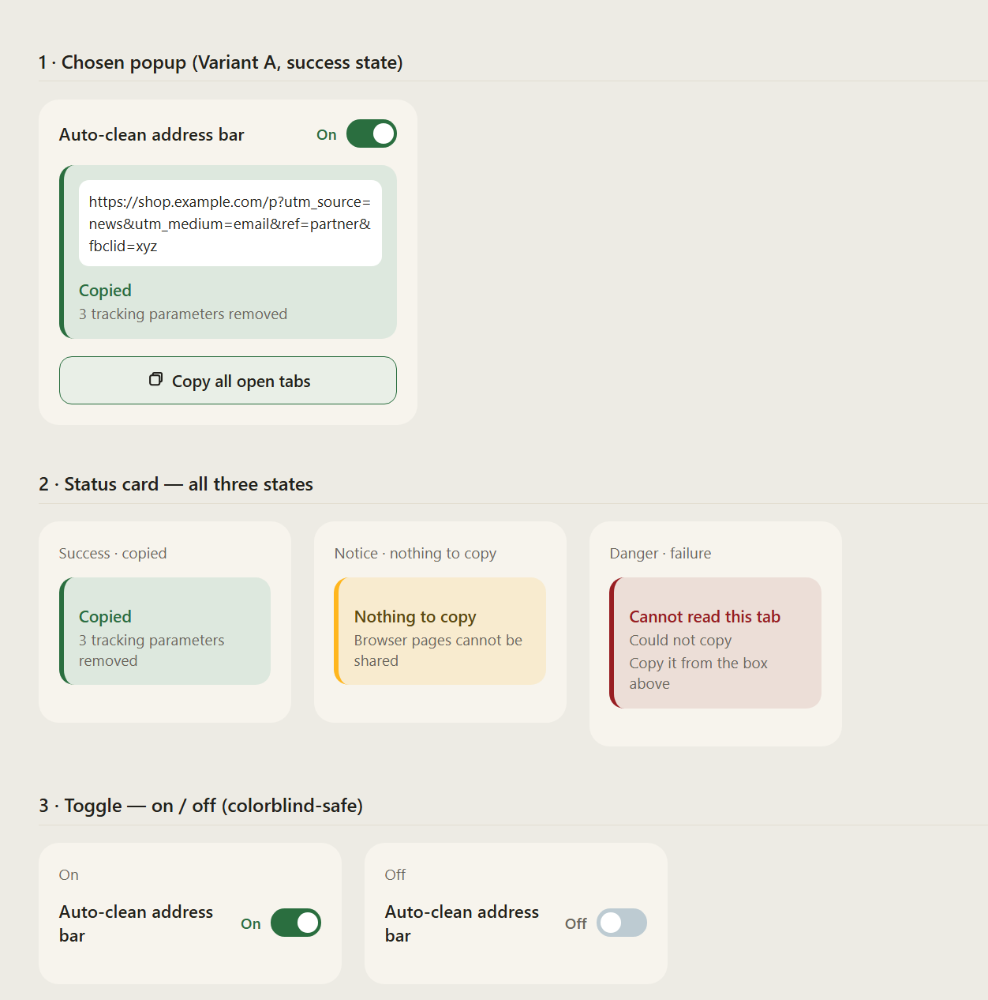
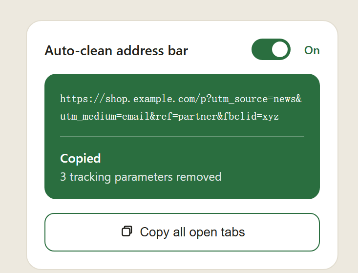
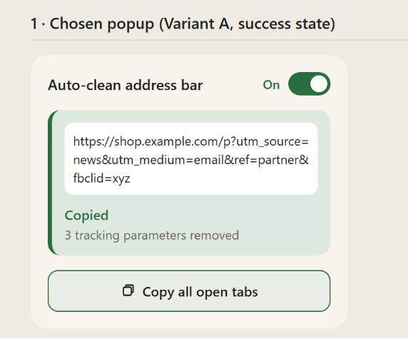
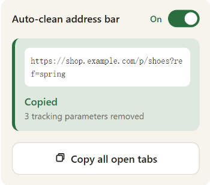

# 2.7 popup design (automatic cleaning in Get Clean URL)

Decided 2026-10-24. This design assumes automatic cleaning is built into Get Clean URL as an experimental switch, not published as a separate extension. Details are settled when that work starts.

## Chosen: Stacked

- The popup is on `paper`, Copy all open tabs is a plain white button, and the status card is the only coloured element, so colour always means state.
- The status cards and the switch come from the state sheet below.

- **One card structure for every state:** a pale tint, a bar on the left, a coloured title and a grey second line.
  - Green: copied.
  - Yellow: nothing was copied, but nothing went wrong.
  - Red: something failed.
- **The switch says On or Off in words** and moves its knob, so the state never depends on colour alone.
- **Not taken from the state sheet:** the green-tinted, green-bordered button. It competes with the green card and clashes with the yellow and red ones.

## Fix before building

Contrast was measured on the mockups.

- The grey second line is 4.48:1 on the green card and 4.30:1 on the red one, below 4.5:1. Darken it; one colour covers all three cards.
- The Off track is 1.51:1 against the card, and a control needs 3:1. Darken the track or give it an outline.
- The URL box shows the cleaned URL that was copied, not the original.
- Red is two states, each with its own second line:
  - `Cannot read this tab` / `Try reloading the page`, with no URL box.
  - `Could not copy` / `Copy it from the box above`, with the box.
- Name an English monospace font for the URL, for example Consolas. The default falls back to a CJK font on Chinese Windows and leaves wide gaps after the dots.
- Break the URL after `?` and `&`, not inside a parameter name.

## Still to draw

- The green card with `Copied` / `No tracking parameters removed`. This message is also decided for the next release.
- The switch when it is off.
- The permission request the first time the switch is turned on, and what happens if it is declined.
- An experimental label on the switch.

## Open

- **Where the switch goes:** at the top as drawn, or below Copy all open tabs. Below is recommended, since copying is why the popup opens.
- **What the message says when automatic cleaning is on:** most clicks will find nothing left, so it could say what the page lost when it opened, rather than only `No tracking parameters removed`. The icon count already has that number.

## Other candidates (not chosen)

| Solid card | Tinted | Stacked, small |
| --- | --- | --- |
|  |  |  |

- **Solid card:** a long white URL on solid green is hard to read, and it is too strong to see on every click. Its monospace also falls back to a CJK font.
- **Tinted:** the source of the card structure. Its green button is the one not taken.
